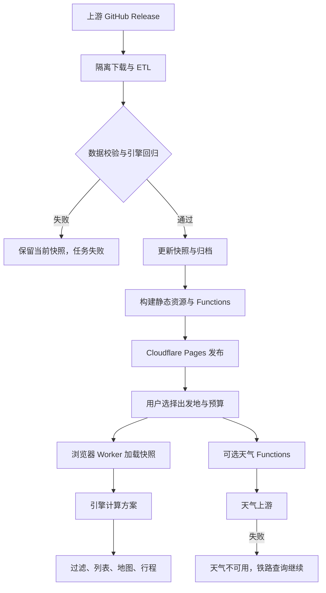

# 铁路可达圈架构

为临时出行、周末旅行和多地碰头提供铁路目的地选择。核心交付是可解释的耗时、
车次与衔接方案。购票、余票和实时停运由 12306 提供；天气和公布票价是辅助信息。

| 模块 | 接口、所有者与限制 |
|---|---|
| 数据与发布 | [delivery](docs/specs/delivery.md)：生成 net.json / manifest，发布只消费已验证产物 |
| 铁路探索 | [exploration](docs/specs/exploration.md)：引擎对象和 Worker 消息，运行时不依赖更新脚本 |
| 天气 | weather_core.js 拥有上游协议，weather.js 绘制，functions/api/weather 缓存/HTTP；不能决定铁路可达性 |
| 本地预览 | server.js 提供开发 HTTP/API；生产查询在 Worker 内，不部署 Node 常驻服务器 |

唯一来源：引擎 `lib/engine.js`、当前快照 `public/data/net.json`、归档清单
`public/data/manifest.json`。表单和 Views 各自拥有查询输入，结果从输入派生；
保存地点使用稳定名称，数组下标仅属于当前引擎实例。

不变量：北京时间、14 天窗口、同站换乘至少 15 分钟、最多两次换乘；
快照验证失败不能发布；归档至少 31 天且保留前一份。天气/底图失败不阻塞铁路计算。

入口与检查命令见 [README](README.md)。历史前端拆分顺序：已提取 Worker 通信、地点保存、统一统计、详情/行程与票价模块；
后续拆分表单事件、列表和天气绘制；每次提取完整职责并做真实浏览器回归。
