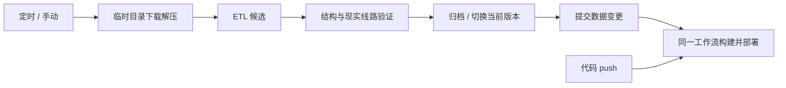

# 数据更新与 Cloudflare 发布

承诺：可部署 Cloudflare Pages，定时检查上游，通过校验后发布；下载、生成、
测试或部署失败明确失败，不将损坏候选替换为线上数据。

update_dataset.py 拥有更新事务，etl.py 拥有 GTFS 转换。dry-run 只读。
候选验证通过前不修改公开文件、原始数据和 RELEASE。归档从本地首次保存起
至少留 31 天，且始终保留前一份。网络重试有上限，Token 只发给 GitHub API。
`--rebuild-local` 复用同一事务，用已下载且版本匹配的 GTFS 重建；不会直接覆盖公开快照。
省份由本地 GeoJSON 边界判断，明确城市映射仅补边界遗漏；无法确定时不猜测。

构建同步引擎源码，检查 Cloudflare 文件大小和数据完整性。GitHub Actions 显式
调用 Wrangler，不依赖机器人 push 触发另一工作流。Wrangler 版本由锁文件固定；
凭据缺失时部署失败并说明所需变量。天气和公布票价 API 调用 Functions，铁路走静态资源。
发布前再次核对 main 最新提交，过期任务跳过，避免旧代码覆盖较新生产版本。

验证：更新失败路径、归档边界、引擎跨日/换乘回归、真实新快照下载、Functions 构建、
Wrangler 环境浏览器查询。云端发布另记证据，本地模拟不冒充上线。
